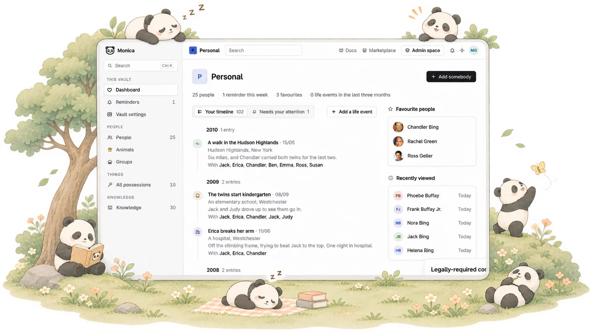

  <picture>
    <source media="(prefers-color-scheme: dark)" srcset="docs/github/app_dark_mode.webp">
    
  </picture>

<h1 align="center">Monica</h1>

  <em>Your personal CRM and database. The OG.</em>

  

  
  
  
  

  
  
  
  

## Introduction

Monica is an open-source web application that enables you to document your life, the people you care about, the things you own, and whatever else. Imagine a CRM—a commonly used tool by sales teams in the corporate world, but for your friends and family, and life.

Monica is a single user application. It runs as a hosted service, and you can host it yourself for
free, with no limit.

### Who is it for?

This project is for people who want to document their lives and those who have difficulty remembering details about the lives of people they care about.

We’ve also had a lot of positive reviews from people with Asperger syndrome, Alzheimer’s disease, and introverts who use our app every day.

### Who is it not for?

We've had many criticisms over the years about this tool. "Do you really need a tool for that?" or "It's sad that we need this kind of tools in our lives".

Monica is **clearly** not for everybody. We hope you don't need it. But some people do (see above). I know I do.

### What Monica isn't

- Monica is not a social network and it never will be. It’s not meant to be social. It’s designed to be the opposite: it’s for your eyes only.
- Monica is not a smart assistant. It won’t guess what you want to do. It’s actually pretty dumb: it will only send you emails for the things you asked to be reminded of.
- Monica does not have built-in AI with integrations like ChatGPT. But we do play very very nice with AI agents.
- Monica is not a tool that will scan your data and do nasty things with it. It’s your data, your server, do whatever you want with it. You’re in control of your data. We really don't want to own your data.

## Main features

- **Vaults** keep separate parts of your life apart, such as family, friends and work.
- **Contacts** hold what you know about each person, laid out by templates you design.
- **Life events** are written once and appear both in the journal and in the history of every person
  involved.
- **Relationships and groups** describe how the people you know are connected.
- **Reminders** bring back the dates that matter, by email or through another notification channel.
- **Possessions and locations** track the things you own and the places in your life.
- **A JSON API and an MCP server** let your own scripts and AI assistants work with your data.

## Documentation

A running instance serves its own documentation:

| Address | What it holds |
| --- | --- |
| `/docs` | The product guide, for people using Monica |
| `/docs/api` | The reference of the JSON API |
| `/docs/mcp` | The tools the MCP server offers to AI assistants |

The guide is written in `docs/portal`, the API reference in `resources/docs/api`, and the
specification of each feature in `specs`.

You can find all the online document in https://my.monicahq.com/docs.

## Contribute

Do you want to lend a hand? That’s great! We accept contributions from everyone, regardless of form.

Here are some of the things you can do to help.

### Contribute as a community

- Unlike Fight Club, the best way to help is **to actually talk about Monica** as much as you can in blog posts and articles, or on social media.
- You can answer questions in [the issue tracker](https://github.com/monicahq/monica/issues) to help other community members.
- You can financially support Monica’s development [on Patreon](https://www.patreon.com/monicahq) or by subscribing to [a paid account](https://monicahq.com/pricing).

## Principles, vision, goals and strategy

### Vision

Monica’s vision is to **help document their lives**.

### Principles

Monica has a few principles.

- It should help improve relationships.
- It should be simple to use, simple to contribute to, simple to understand, extremely simple to maintain.
- It is not a social network and never will be.
- It is not and never will be ad-supported.
- Users are not and never will be tracked.
- It should be transparent.
- It should be open-source.
- It should do one thing (documenting your life) extremely well, and nothing more.
- It should be well documented.

### Goals

We want to provide a platform that is:

- **really easy to use**: we value simplicity over anything else.
- **open-source**: we believe everyone should be able to contribute to this tool, and see for themselves that nothing nasty is done behind the scenes that would go against the best interests of the users. We also want to leverage the community to build attractive features and do things that would not be possible otherwise.
- **easy to contribute to**: we want to keep the codebase as simple as possible. This has two big advantages: anyone can contribute, and it’s easily maintainable on the long run.
- **available everywhere**: Monica should be able to run on any desktop OS or mobile phone easily. This will be made possible by making sure the tool is easily installable by anyone who wants to either contribute or host the platform themselves.

### Why Open Source?

Why is Monica open source? Is it risky? Could someone steal my code and use it to start a for-profit business that could hurt my own? Why reveal our strategy to the world? We’ve already received these kinds of questions in our emails.

The answer is simple: yes, you can fork Monica and create a competing project, make money from it (even if the license is not ideal for that) and we won’t be aware. But that’s okay, we don’t mind.

We wanted to open source Monica for several reasons:

- **We believe that this tool can really change people’s lives.**
  We aim to make money from this project, but also want everyone to benefit. Open sourcing it will help Monica become much bigger than we imagine. We believe the software should follow our vision, but we must be humble enough to recognize that ideas come from everywhere and people may have better ideas than us.
- **You can’t make something great alone.**
  While Monica could become a company and hire a bunch of super smart people to work on it, you can’t beat the manpower of an entire community. Open sourcing the product means bugs will be fixed faster, features will be developed faster, and more importantly, developers will be able to contribute to a tool that positively changes their own lives and the lives of other people.
- **Doing things in a transparent way leads to formidable things.**
  People respect the project more when they can see how it’s being worked on. You can’t hide nasty things in the code. You can’t do things behind the backs of your users. Doing everything in the open is a major driving force that motivates you to keep doing what’s right.
- **Once you’ve created a community of passionate developers around your project, you’ve won.**
  Developers are powerful influencers: they create apps, discuss your product on forums, and share it with their networks. Nurture your relationship with developers – users will follow.

### Patreon

You can support the development of Monica [on Patreon](https://www.patreon.com/monicahq). Thanks for your help.

## Contact

## Team

Our team is made of two core members:

- [Regis (djaiss)](https://github.com/djaiss)
- [Alexis Saettler (asbiin)](https://github.com/asbiin)

We are also fortunate to have an amazing [community of developers](https://github.com/monicahq/monica/graphs/contributors) who help us greatly.

## Thank you, open source

Monica makes use of numerous open-source projects and we are deeply grateful. We hope that by offering Monica as a free, open-source project, we can help others in the same way these programs have helped us.

## License

Copyright © 2016–2026

Licensed under [the AGPL License](/LICENSE.md).
