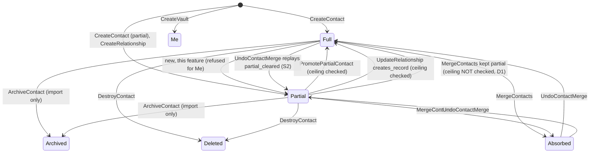

# Analysis: making a full contact partial

Prepared on 2026-11-23 for [spec.md](spec.md), by reading the code on branch
`2026-11-23-partial-contact-promotion`. Paths are relative to the repository root.

## A. Where the partial state is read today

`contacts.is_partial` is a boolean. Every reader below changes behaviour when a full contact becomes
partial, so each is a consequence of this feature.

| # | Surface | What a partial contact gets | Where |
| --- | --- | --- | --- |
| A1 | List of people | Absent, except in the "Names only" grouping | `Contact::scopeListed()`, `Contact::scopeInGrouping()` |
| A2 | Plan ceiling | Not counted | `Account::contactCount()` (`app/Models/Account.php:779`) |
| A3 | Relationship blocks, family tree, timeline participants, a contact field's value | The name without a link to the page | `RelationshipsBlock.php:159`, `ImmediateFamilyBlock.php:130`, `FamilyTreeBlock.php:102`, `ContactTimelineBlock.php:190`, `components/field-value.blade.php:38` |
| A4 | Relationship edit screen of the other side | The partial side can be renamed through the relationship, and "creates a record" is offered | `RelationshipEditViewModel::otherState()`, `UpdateRelationship.php:114` |
| A5 | CardDAV address book | Removed from the phone; reported as deleted in the sync changes | `AddressBookBackend.php:399`, `CollectionChanges.php:163` |
| A6 | CardDAV group card | Left out of the group's members | `GroupVCard.php:75` |
| A7 | CalDAV birthday calendar | Birthday absent | `CalendarBackend.php:339` |
| A8 | Vault reminders screen | A birthday without a reminder is not suggested | `VaultReminderDates.php:205` |
| A9 | Vault list and dashboard | Not counted, not shown as a link | `VaultsViewModel.php:87`, `VaultDashboardViewModel.php:136,171,202`, `GroupHistoryBlock.php:111` |
| A10 | Account export and import, snapshot | The flag is carried | `WriteAccountExport.php:297`, `ReadMonicaFile.php:221`, `CreateRecordSnapshot.php:108` |
| A11 | API | Exposed on the contact, filterable on the summary list, settable at creation only | `ContactResource.php:47`, `ContactSummaryController.php:38`, `Api/ContactController.php:125` |
| A12 | MCP | Settable at creation only | `app/Mcp/Tools/CreateContact.php:52` |

Not read, so unchanged by the state:

- **Search** (`SearchViewModel`, `Contact::scopeMatchingSearch()`): a partial contact is found. Design 2b claims otherwise.
- **Reminder delivery** (`DeliverNotifications`): checks `is_archived` only, so a partial contact's reminders fire. Design 1c claims otherwise.
- **Duplicate detection** (`DetectDuplicateContacts`): partial contacts are candidates.
- **Vault `contact_count`**: incremented for every contact at creation, partial or not (`CreateContact.php:165`).

## B. What has to be built

1. An action making a full contact partial: refuse another account (not found), the contact
   representing the account holder, a contact already partial; set the flag; journal it. It needs
   the same lock on the account row as the promotion, so a promotion and a demotion of two contacts
   cannot interleave around the ceiling.
2. A policy, since the rule "the account holder's contact cannot be partial" is stated twice: by
   the edit screen, which draws the panel refused, and by the action. `ContactPolicy` already holds
   `delete` with the same refusal, so a `demote` ability (final name in the plan) sits next to it,
   with its three tests (permitted, refused, nobody signed in) as `PolicyCoverageTest` requires.
3. A web route and controller, the panel on `resources/views/app/vaults/contacts/edit.blade.php`
   above `x-delete-section`, and the confirmation with `x-modal.form`.
4. The edit page's view model gives the panel its copy and its refusal.
5. API endpoints for both directions (the promotion built on this branch has none yet), their
   controller tests, the API reference and its changelog, and two MCP tools answering through them.
6. A journal case (`UserActionEnum`), translations in every locale, a What's new entry.
7. The three answers recorded in the spec: partial contacts stay outside the ceiling, stay in search, and a contact without a relationship may become partial with a warning in the confirmation. That warning needs the action or the view model to know whether any relationship reaches the contact.

## C. State machine of a contact

The states are derived from columns, and stay implicit, as `docs/STATE_MACHINE_AUDIT.md` recommends.
This feature adds the edge from Full to Partial. The edge from Partial to Full by its own button is
already added on this branch.

`is_partial` and `is_archived` are independent columns, so "partial and archived" is a reachable
state (an imported contact that was both). The demotion action should refuse an archived contact,
which no screen reaches anyway.

## D. Defects and risks found

**D1. A merge can lift a contact past the ceiling (existing, medium).** `MergeContacts::stopBeingPartial()`
(`app/Actions/MergeContacts.php:521`) clears the partial state of the kept contact without asking
`ContactPolicy::create`. Merging a full contact into a partial one is neutral (one counted contact
absorbed, one made counted). Merging one partial contact into another produces one counted contact
from none, with no check. Once demotion exists, this becomes a repeatable way past the ceiling:
demote two contacts, merge them, demote the result. Fix: ask the policy in the merge when the count
would rise, under the account lock.

**D2. The ceiling can be bypassed by demotion itself (new, accepted).** A partial contact keeps every
capability of a full one and counts for nothing. Accepted on 2026-11-23, see the spec's Clarifications.
D1 still matters: the ceiling must hold on every way back to full.

**S1. Leaving the phone (new, must be said).** Demotion reports the card as deleted to every
synchronised address book (A5) and removes the birthday from the calendar (A7). Promotion brings
both back. A phone that edited the card offline and syncs after the demotion still reaches the
contact by its uid (`AddressBookBackend.php:164`), which is fine; a phone that recreates the card
instead would get a new contact. UNCONFIRMED: how iOS and DAVx5 behave when a card they hold is
reported deleted while they hold unsent local changes.

**S2. Undoing a merge replays a stale state (existing, low).** `UndoContactMerge::makeItPartialAgain()`
sets the flag back to true whatever the contact's state is now. With demotion and promotion available,
somebody who promoted the kept contact after the merge sees it become partial again on undo, and the
undo does not ask the ceiling in the other direction either. Low, because the result is visible and
reversible, but the undo's confirmation should say it.

**S3. Reachability (new, decision).** A partial contact's page is not linked from any relationship
block (A3). The band built on this branch, and the way back promised by design 2a, are only reached
through "Names only" and search. Search keeps partial contacts (decided), so search and "Names only" stay the two ways in.

**S4. Copy that is false today.** Design 1c: "No reminders, even for the birthday". Design 2b:
"will no longer appear in People or in search", and "you reach him through the people he is linked
to". Design 1a (as drafted): "get reminders and keep notes". None of these matches the product.
Also `ContactController.php:188` and `ContactsViewModel.php:268` say a partial contact stays off the
list "until they are more than a first name", which nothing implements.

**S5. Concurrency.** The promotion locks the account row and then asks the policy. The demotion
needs the same lock so that two requests (a promotion here, a contact created elsewhere) are
ordered. Without it, two promotions in parallel at 29 of 30 both pass.

**S6. Two meanings of "count".** The vault's `contact_count` includes partial contacts; the account's
`contactCount()` does not. Demotion changes the second only. Any screen that shows one beside the
other will disagree, which is existing behaviour, not made worse.

## E. Tests the plan will need

- Action: demotes; refuses another account, the account holder's contact, a contact already partial,
  an archived contact; journals; frees a place under the ceiling.
- Policy: the new ability, three ways.
- Controller: answers, the refusal reaches the form, wrong vault is not found.
- View model of the edit page: panel present for a full contact, absent for a partial one, refused for
  the account holder's.
- API and MCP: both directions, refusals as 422, the resource reports the state.
- Merge: two partial contacts at the ceiling are refused (D1).
- CardDAV: a demoted contact is reported in the removed set of the sync changes (already true; a
  regression test is worth it since the feature now relies on it).
